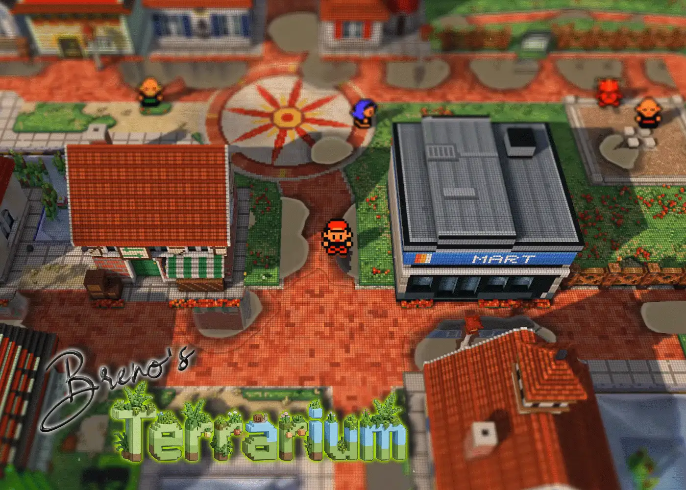

# Terrarium

**Kanto as a little world under glass.** A mod for the
[Pokémon Gen 1 Recompilation Project](https://github.com/bryanthaboi/gen1recomp)
that turns the Red / Blue / Yellow overworld into a living 3D diorama, with its
own weather, its own hours, and things living in it.

It changes what Kanto **looks** like and nothing about how it **plays**. Every
feature has an OFF switch, and with all of them off the game is exactly the
game.

> Gen 1 only (Red, Blue, Yellow). This is Wooble's English fork of
> [BrenoBertucci's Terrarium](https://github.com/BrenoBertucci/Terrarium),
> which is built on the
> [Dramatic Shape Voxel Mod](https://github.com/DramaticShape/DramaticShapeVoxelMod).
> Go and see both. See [Credits](#credits) for who made what.

---

## What you get

### A world you can stand in

- The map extruded into real 3D: buildings, trees, ledges you can see the drop
  of, and real cast shadows that stretch through the afternoon.
- Lavender, Vermilion and their routes rebuilt by hand: the Pokémon Tower,
  timber bridges and piers, a water garden of reeds and lilies.
- Water you can disturb. Surfing, rain and a fishing float leave ripples that
  spread and bounce off the bank.
- Tall grass that bends in the wind, flattens where you walk, and springs back.

### Sky, time and weather

- A full day and night: dawn, golden hour, dusk, a starry night with the odd
  meteor. Run it on its own clock, pin it, or sync it to your real one.
- Rain you watch roll in from the horizon, storms that flash, puddles that
  linger afterwards, snow that settles, footprints behind everyone.
- Volumetric clouds whose shadows drift across the ground, and street lamps and
  lit windows after dark.

### Life and sound

- Butterflies and birds by day, dragonflies over water, fireflies at night,
  flocks overhead, smoking chimneys, a haunted tower.
- Ambient sound for each place: crickets, birdsong, water, wind, rain and
  thunder (all CC0 recordings).

### Battles on the map

- Fights happen right where you are, on the nearest clear ground, with a
  camera that swings in behind whoever is attacking.
- A modern battle interface in dark glass (or the original ivory), floating
  move cards, hit effects that scorch, splash or freeze the ground.

### Extras

- A 3D Town Map built from the real map data, a radar, a Mario 64-style follow
  camera, a miniature tilt-shift look and a curved-world mode.

The full list, with every option explained, is in [`FEATURES.md`](FEATURES.md).

---

## Install

1. Get [Gen1Recomp](https://github.com/bryanthaboi/gen1recomp) (v0.1.37 or
   newer) running with a ROM you dumped from your own cartridge.
2. Download the latest `TERRARIUM-x.y.z.zip` from
   [Releases](https://github.com/poooooby/Terrarium/releases).
3. In the game, open **MODS → Import mod .zip** and pick it. (Or unzip it into
   `mods/TERRARIUM` yourself.)

Then load your save and look around. The settings live in **OPTIONS → OPEN TERRARIUM**.

## Settings and performance

Every feature is a row on the **TERRARIUM** page (**OPTIONS → OPEN TERRARIUM**), and every row has an OFF. If
something is too slow, too bright or too much, switch that row off; nothing
depends on anything else.

On a weaker PC or a phone, start with these:

| Row | Try |
| --- | --- |
| **RESOLUTION** | 1/3 or 1/4 (the 3D pass renders smaller and scales up crisply) |
| **SHADOWS** | LOW or OFF |
| **PARTICLES** | LOW |

Terrarium was built to run on an entry-level Android phone and a laptop with
integrated graphics, so the defaults are already modest.

**Hotkeys** (free roam): `v` 3D camera · `t` tilt-shift · `c` world curve ·
`g` wireframe · `b` 3D battles · `p` radar · `h` distance fog · `k` horizon ·
`m` follow cam · `j` preview the next hit effect.

## Plays well with

- **[G9 Battle Sprites](https://github.com/tectorifter/g9-battle-sprites)**:
  its animated full-colour sprites stand in the 3D battles.
- **[Porygonal](https://github.com/CurlyG004/porygonal-overworld-characters)**:
  modelled 3D characters in the diorama, through the adapter in
  [`compat/porygonal/`](compat/porygonal/README.md).
- **Kanto Gear** and other battle-UI mods: set **BATTLE UI** to DYNAMIC
  MINIMAL or MINIMAL and the other mod draws the menus.
- The original Dramatic Shape mod can be installed alongside it (different
  id, folder and keys), but only turn one 3D view on at a time.

**Optional art.** A sky flock can wear Gen 2-style sprites if you install them
with [`tools/install_roamer_sprites.py`](tools/install_roamer_sprites.py); they
are not included for licensing reasons, and the mod works fine without them.

---

## Credits

- **[Dramatic Shape](https://github.com/DramaticShape/DramaticShapeVoxelMod)**:
  the voxel diorama, the shadows, the tilt-shift and the over-the-shoulder
  battles this all grew from.
- **[BrenoBertucci](https://github.com/BrenoBertucci/Terrarium)**: Terrarium
  itself. The low-end tuning, the weather and sky, the rebuilt towns, the
  water, the wildlife and the battle interface.
- **This fork (Wooble)**: the English interface (Portuguese stays available
  under **LANGUAGE**), Breno's final unreleased build merged in, every gameplay
  change removed so it is purely visual, the dark glass battle theme, and
  performance and compatibility fixes. See [`CHANGELOG.md`](CHANGELOG.md).
- **[bryanthaboi](https://github.com/bryanthaboi/gen1recomp)** and the
  Gen1Recomp contributors, for the engine and its mod platform.
- **Roy Stan's [Toon Water Shader](https://roystan.net/articles/toon-water/)**,
  the inspiration for the water's look.
- **Ambient audio**: CC0 recordings by Wolfgang_, isaiah658, Ylmir,
  rubberduck, Luke.RUSTLTD, TinyWorlds, JaggedStone, RandomMind, craigsmith,
  Littleboot, PagDev and Siobhan Leachman. Sources in
  [`assets/audio/CREDITS.md`](assets/audio/CREDITS.md).

## Legal

Pokémon Red, Blue and Yellow are © 1996–1999 Nintendo, Creatures Inc. and GAME
FREAK Inc. This is an unofficial, non-commercial fan mod, not affiliated with
or endorsed by any of them. It contains **no ROM, no game code and no
Nintendo art or audio**; it needs a copy of the game you already own. Please
don't ask for or link ROMs in issues. If a rights holder objects to anything
here, open an issue and it will be taken down.

Neither upstream project has a licence file yet, so neither does this fork. If
you want to build on it, talk to BrenoBertucci and Dramatic Shape first.

**Made with AI assistance.** Much of this fork was written with AI coding
assistants (Anthropic's Claude among them), directed and tested by a human,
with much of it checked by probes that drive the real game. If you'd rather
avoid AI-assisted code, the
[original mod](https://github.com/DramaticShape/DramaticShapeVoxelMod) is
excellent.

---

**More:** [`FEATURES.md`](FEATURES.md) (the full manual) ·
[`CHANGELOG.md`](CHANGELOG.md) · [`ROADMAP.md`](ROADMAP.md) ·
[Issues](https://github.com/poooooby/Terrarium/issues) · Developers: see
[`CLAUDE.md`](CLAUDE.md) and [`tools/profiler/`](tools/profiler/README.md).
